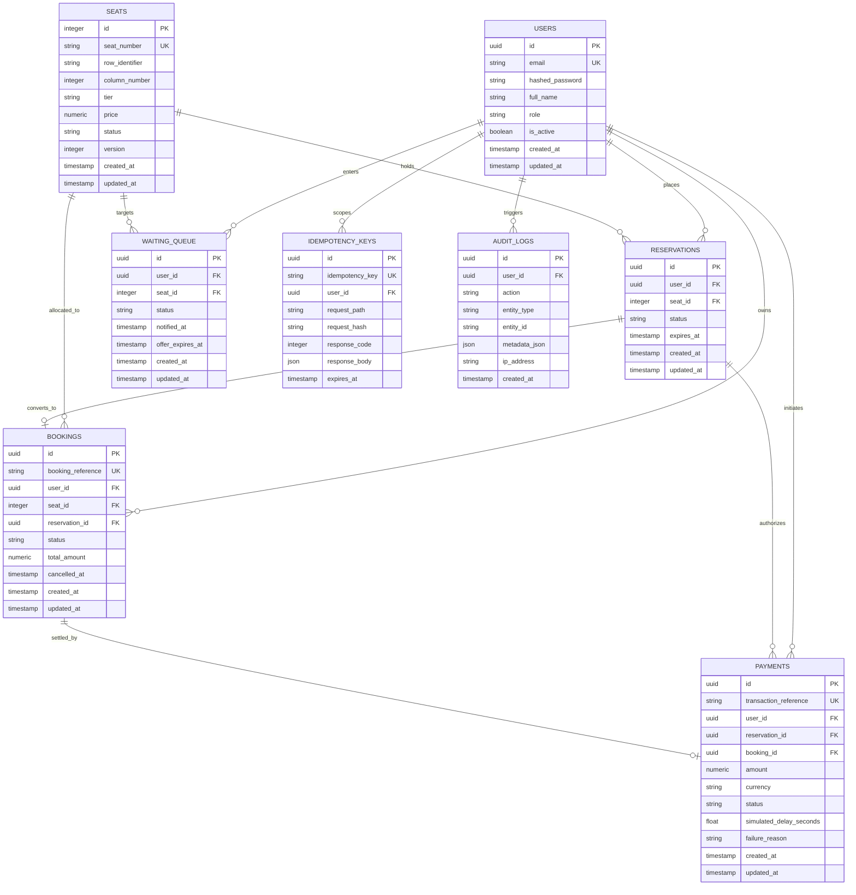

# System Architecture & Technical Specifications
## College Concert Ticket Booking Platform

---

## 1. Architectural Philosophy & Overview

The College Concert Ticket Booking Platform is engineered from the ground up for high-concurrency ticket reservations. In a real-world concert scenario where **10,000 students simultaneously contend for 500 seats**, naive architectures fail with race conditions, phantom reads, and double bookings.

Our platform enforces the fundamental guarantee:
$$\text{One Seat} \longrightarrow \text{One Confirmed Booking} \longrightarrow \text{Never Two Winners}$$

To achieve this without compromising throughput or latency, the platform employs a **defense-in-depth concurrency pipeline**:

```
+------------------------------------------------------------------------------------+
|                                CLIENT LAYER (HTTP / JSON)                          |
+------------------------------------------------------------------------------------+
                                         │
                                         ▼
+------------------------------------------------------------------------------------+
|                    EDGE / REVERSE PROXY LAYER (NGINX)                              |
|  - TLS Termination                                                                 |
|  - Gzip / Brotli Compression                                                       |
|  - Binary Leaky-Bucket Rate Limiting (150 r/s global, 20 r/s auth)                 |
+------------------------------------------------------------------------------------+
                                         │
                                         ▼
+------------------------------------------------------------------------------------+
|                         APPLICATION LAYER (FastAPI Async)                          |
|  - Idempotency Middleware (SHA-256 payload check)                                  |
|  - JWT Stateless Bearer Authentication & Role-Based Access Control                 |
|  - Sub-millisecond Execution Loop                                                  |
+------------------------------------------------------------------------------------+
                   │                                              │
                   ▼                                              ▼
+----------------------------------------+     +-------------------------------------+
|        FAST IN-MEMORY CACHE            |     |        PERSISTENCE STORE            |
|              (REDIS 7)                 |     |         (POSTGRESQL 16)             |
|----------------------------------------|     |-------------------------------------|
| - Distributed Lock (Redlock SET NX PX) |     | - ACID Engine (Read Committed / RR) |
| - Atomic Reservation via Lua Script    |     | - Row-Level Lock (SELECT FOR UPDATE)|
| - Temporary Hold TTL (300 seconds)     |     | - Relational Integrity (3NF)        |
| - Sorted Set FIFO Waiting Queue        |     | - Partial Unique Constraints        |
+----------------------------------------+     +-------------------------------------+
```

---

## 2. Directory & Component Structure

```
d:/pro_2/
│
├── backend/
│   ├── app/
│   │   ├── api/                      # Routing & HTTP Layer
│   │   │   ├── auth.py               # User registration, login, token issuance
│   │   │   ├── seats.py              # Seat discovery, reserve, confirm, cancel
│   │   │   ├── bookings.py           # Confirmed bookings & user history
│   │   │   ├── reservations.py       # Active reservation inspection & TTL status
│   │   │   ├── payments.py           # Simulated payments & audit inquiries
│   │   │   ├── queue.py              # FIFO waitlist join and polling
│   │   │   ├── admin.py              # Administrative studio, metrics, live burst test
│   │   │   └── health.py             # Liveness/Readiness probes & metrics
│   │   │
│   │   ├── core/                     # Infrastructure & Core Engine
│   │   │   ├── config.py             # Pydantic BaseSettings environment config
│   │   │   ├── database.py           # Async SQLAlchemy engine, session maker, pool
│   │   │   ├── redis_client.py       # Async Redis connection pool & test fallback
│   │   │   ├── security.py           # Bcrypt password hashing & JWT tokens
│   │   │   └── dependencies.py       # FastAPI dependency injectors (Auth, DB, Redis)
│   │   │
│   │   ├── models/                   # PostgreSQL 3NF Relational Schema
│   │   │   ├── base.py               # Base class, UTC helpers, UUID generator
│   │   │   ├── user.py               # Users table (roles: student, admin)
│   │   │   ├── seat.py               # Seats table (500 seats: VIP, Standard, Balcony)
│   │   │   ├── reservation.py        # Temporary holds (Pending, Confirmed, Expired)
│   │   │   ├── booking.py            # Permanent bookings with unique reference codes
│   │   │   ├── payment.py            # Simulated transactions & outcomes
│   │   │   ├── waiting_queue.py      # FIFO waitlist entries
│   │   │   ├── idempotency.py        # Idempotency keys & cached responses
│   │   │   └── audit.py              # Immutable compliance audit log
│   │   │
│   │   ├── schemas/                  # Pydantic v2 validation contracts
│   │   ├── repositories/             # Data access layer (Decoupled SQL execution)
│   │   ├── services/                 # Business logic orchestrators
│   │   │   ├── auth_service.py       # Authentication & account lifecycle
│   │   │   ├── seat_service.py       # Atomic seat reservation & Redis locks
│   │   │   ├── booking_service.py    # ACID confirmation & row-level locking
│   │   │   ├── payment_simulator.py  # Non-deterministic payment latency & outcomes
│   │   │   └── queue_service.py      # Redis Sorted Set FIFO queue manager
│   │   │
│   │   ├── middleware/
│   │   │   └── idempotency.py        # Header deduplication & fast replay
│   │   │
│   │   ├── workers/
│   │   │   └── expiry_worker.py      # Background sweeper (SELECT FOR UPDATE SKIP LOCKED)
│   │   │
│   │   ├── utils/
│   │   │   ├── lua_scripts.py        # Atomic Lua scripts for Redis execution
│   │   │   └── redis_lock.py         # Distributed lock with Redlock release token
│   │   │
│   │   └── main.py                   # FastAPI application factory & lifespan
│   │
│   ├── migrations/                   # Alembic schema migrations
│   ├── tests/                        # Pytest async concurrency test suite
│   ├── alembic.ini
│   ├── pytest.ini
│   ├── requirements.txt
│   └── Dockerfile
│
├── frontend/
│   ├── src/
│   │   ├── components/
│   │   │   ├── Navbar.tsx            # Minimalist header with live ACID status
│   │   │   ├── SeatGrid.tsx          # 500-seat visual map (Rows A-T, Cols 1-25)
│   │   │   ├── ReservationDrawer.tsx # Hold timer (5:00), payment simulator controls
│   │   │   └── WaitingQueueModal.tsx # FIFO waitlist position & opportunity claim
│   │   ├── context/
│   │   │   └── AuthContext.tsx       # Auth provider & demo persona switcher
│   │   ├── pages/
│   │   │   ├── StudentDashboard.tsx  # Interactive seat grid & active holds
│   │   │   ├── HistoryPage.tsx       # My Bookings, Cancellation, & Audit Timeline
│   │   │   ├── AdminDashboard.tsx    # Observability, live concurrency burst runner
│   │   │   └── LoginPage.tsx         # Clean sign-in & demo credentials
│   │   ├── services/
│   │   │   └── api.ts                # Axios client with idempotency injection
│   │   ├── types/
│   │   │   └── index.ts              # Domain interfaces
│   │   ├── App.tsx
│   │   └── index.css                 # Monochrome styling tokens
│   │
│   ├── package.json
│   ├── vite.config.ts
│   └── Dockerfile
│
├── docker/
│   └── nginx.conf                    # Reverse proxy, rate limiting, gzip
│
├── load-testing/
│   ├── locustfile.py                 # Locust high-contention test scenario
│   └── run_load_test.py              # Automated test runner & invariant verifier
│
├── docs/
│   ├── ARCHITECTURE.md               # This document
│   └── CONCURRENCY.md                # Deep-dive concurrency paper
│
├── docker-compose.yml
└── README.md
```

---

## 3. Database Architecture (Third Normal Form)

All tables adhere to 3NF standards. No non-prime attribute is transitively dependent on any candidate key.

### Entity-Relationship Diagram



---

## 4. End-to-End Transaction Flows

### 4.1 Reservation Flow (Two-Phase Edge & DB Check)
```
User Request: POST /seats/{id}/reserve
  │
  ├── 1. Acquire Redis Lock: lock:seat:{id} (Token: UUID, TTL: 4000ms)
  │      └── If unable to acquire within 2s -> 429 Too Many Requests
  │
  ├── 2. Execute Redis Lua Script: RESERVE_SEAT_LUA
  │      ├── Check: seat:{id}:booked exists? -> Return 0 (409 Conflict)
  │      ├── Check: seat:{id}:reservation exists? -> Return -1 (409 Conflict)
  │      └── Atomically set seat:{id}:reservation = reservation_id (EX 300s)
  │
  ├── 3. Open DB Transaction & Acquire Row Lock
  │      └── SELECT * FROM seats WHERE id = :id FOR UPDATE
  │      ├── Verify seat.status == 'Available'
  │      └── Check no active pending reservation in reservations table
  │
  ├── 4. Insert Reservation Record
  │      └── status: 'Pending', expires_at: NOW() + 300s
  │
  ├── 5. Update Seat status = 'Reserved', version += 1
  │
  ├── 6. Commit DB Transaction & Release Redis Lock
  │
  └── Return 200 OK: { reservation_id, expires_at, remaining_seconds: 300 }
```

### 4.2 Booking Confirmation Flow (ACID & SELECT FOR UPDATE)
```
User Request: POST /seats/{id}/confirm
  │
  ├── 1. Acquire Redis Lock: lock:seat:{id}
  │
  ├── 2. Begin ACID Transaction (PostgreSQL)
  │
  ├── 3. Execute Row Lock:
  │      SELECT * FROM seats WHERE id = :seat_id FOR UPDATE;
  │      (Acquires exclusive row-level lock; blocks concurrent transactions on this seat)
  │
  ├── 4. Validate State Invariants:
  │      ├── seat.status != 'Booked' (if booked -> 409 Conflict)
  │      ├── reservation exists, status == 'Pending', user_id matches, expires_at > NOW()
  │
  ├── 5. Execute Payment Simulation (1–8s delay)
  │      ├── [Outcome: Succeeded or Delayed Success]
  │      │     ├── Create Booking: status = 'Confirmed', booking_reference = 'BK-XXXX-YYYY'
  │      │     ├── Update Seat: status = 'Booked'
  │      │     ├── Update Reservation: status = 'Confirmed'
  │      │     ├── Create Payment record: status = 'Succeeded'
  │      │     ├── Set Redis: seat:{id}:booked = 1
  │      │     ├── Delete Redis: seat:{id}:reservation
  │      │     ├── Insert AuditLog entry
  │      │     ├── COMMIT TRANSACTION
  │      │     └── Return 200 OK: Booking Confirmed!
  │      │
  │      └── [Outcome: Failed or Timeout]
  │            ├── Update Reservation: status = 'Payment Failed'
  │            │   (Reservation remains active until 5m TTL expires per specification)
  │            ├── Create Payment record: status = 'Failed', reason = ...
  │            ├── Insert AuditLog entry
  │            ├── COMMIT TRANSACTION (persists payment failure record)
  │            └── Return 200 OK / 400 Bad Request with failure reason
  │
  └── 6. Release Redis Lock (Safe Lua Token Verification)
```

### 4.3 Cancellation Flow & Waiting Queue Dispatch
```
User Request: DELETE /seats/{id}/cancel
  │
  ├── 1. Begin DB Transaction & SELECT * FROM seats WHERE id = :id FOR UPDATE
  ├── 2. Verify Booking Ownership
  ├── 3. Mark Booking status = 'Cancelled', cancelled_at = NOW()
  ├── 4. Revert Seat status = 'Available'
  ├── 5. Delete Redis Keys: seat:{id}:booked and seat:{id}:reservation
  ├── 6. Dispatch Waiting Queue:
  │      ├── ZPOPMIN queue:waiting_list (Pops head of FIFO sorted set)
  │      └── If user exists:
  │            ├── Set Redis key queue:user_opportunity:{user_id} = seat_id (EX 180s)
  │            └── Update DB WaitingQueue record status = 'Notified', offer_expires_at = NOW() + 180s
  ├── 7. Insert AuditLog entry
  └── 8. Commit Transaction & Return 200 OK (Seat Released)
```

---

## 5. Horizontal Scaling Strategy

To scale beyond a single host to millions of users:
1. **Stateless FastAPIs**: Application containers run completely statelessly behind Nginx / AWS ALB. Session state resides exclusively in Redis (tokens are cryptographic JWTs).
2. **PostgreSQL Read Replicas**: Queries for seat availability (`GET /seats`) can optionally read from read replicas using asynchronous replication, while all booking confirmations route to the primary writer node with `SELECT FOR UPDATE`.
3. **Redis Cluster with Consistent Hashing**: Seats can be partitioned across Redis shards using hash tags (e.g. `{seat:123}:reservation`).
4. **Partitioned Waiting Queues**: Tier-specific Sorted Sets (`queue:vip`, `queue:standard`, `queue:balcony`) enable parallelized waitlist fulfillment.
