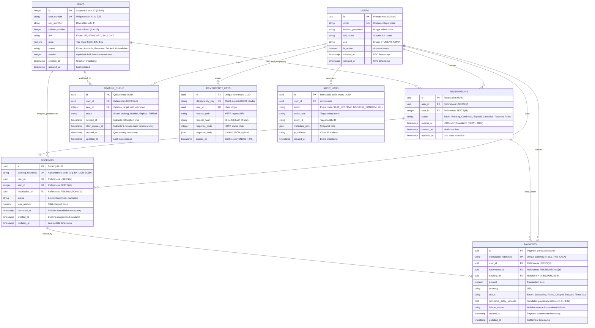
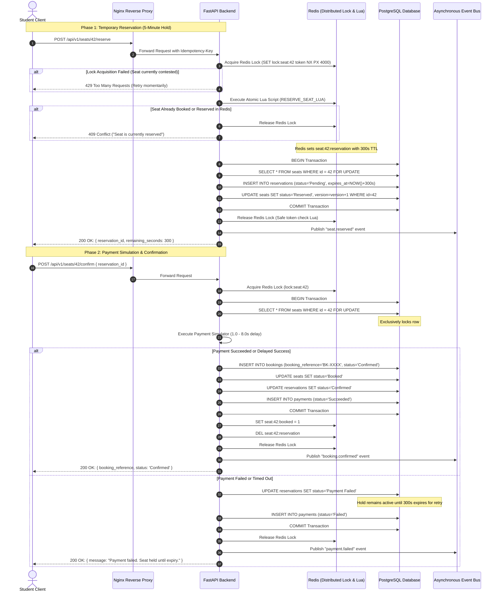
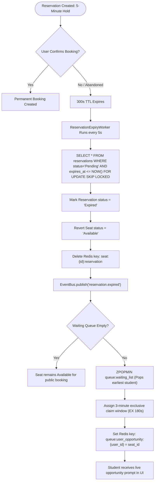
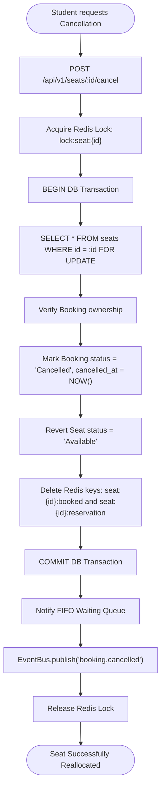

# Entity Relationship Diagram & System Workflows
## College Concert Ticket Booking Platform (CC-VIT 26-27 Recruitment Task)

---

## 1. Entity-Relationship Diagram (3NF)

The database schema is strictly normalized to the Third Normal Form (3NF). Every non-key attribute is non-transitively dependent on the primary key.

---

## 2. Complete Booking Sequence Diagram

This sequence illustrates the end-to-end booking flow including Redis distributed locking, atomic Lua scripting, payment simulation, and row-level database locking (`SELECT ... FOR UPDATE`).

---

## 3. Reservation Expiry & Waitlist Opportunity Flow

When a student abandons their checkout or their 5-minute timer lapses, the background worker automatically recovers the seat and offers it to the FIFO queue.

---

## 4. Cancellation & Seat Reallocation Flow

